### hey 👋

i like making things that leave the screen. sometimes that's a robot dragging plastic out of a sandpit, sometimes it's an app someone's grandparent talks to every morning, and sometimes it's a universe that grows out of a single word because i thought it'd be cool.

when i'm not building, i'm probably stuck on a ctf challenge.

### what i'm messing with right now

- **neurolens** · speech-based dementia monitoring. i do the apps and the backend, which means a lot of flutter, a lot of encryption, and one very expensive azure lesson (it scales to zero now)
- **[aether](https://github.com/Kvin-21/Aether)** · type a word, get a galaxy. no images anywhere, just maths and a 2D canvas pretending to be 3D
- **ctfs** · mostly web and crypto. pwn when i'm feeling brave

### stuff i've made

|                                                                                                                                   |                                                                                                  |
| --------------------------------------------------------------------------------------------------------------------------------- | ------------------------------------------------------------------------------------------------ |
| [neurolens patient](https://github.com/Kvin-21/neurolens-patient-app) + [doctor](https://github.com/Kvin-21/neurolens-doctor-app) | the two apps behind neurolens. recordings get encrypted on the phone before they go anywhere     |
| [aether](https://github.com/Kvin-21/Aether)                                                                                       | a universe from one word. same seed, same universe, every time                                   |
| [alzheimer's mri](https://github.com/Kvin-21/Deep-Learning_MRI-Based_Alzheimers_Detection)                                        | efficientnet + grad-cam, so you can see where the model is actually looking                      |
| [isc-2025](https://github.com/Kvin-21/ISC-2025)                                                                                   | onboard ai for a satellite that cleans up space junk. q-learning decides what to grab first      |
| [focus totem](https://github.com/Kvin-21/Focus-Totem-PCB)                                                                         | an rp2040 study timer on a custom pcb                                                            |
| [rv wellbeing](https://github.com/Kvin-21/rv_wellbeing_extension)                                                                 | a chrome extension for my school. daily mood check-ins and a cat you feed by finishing pomodoros |
| [synthwave os](https://github.com/Kvin-21/WebOS-Synthwave)                                                                        | an 80s desktop in the browser with a winamp-style music player, because why not                  |

### tools

  

### commits, but make it a snake

<picture>
  <source media="(prefers-color-scheme: dark)" srcset="https://raw.githubusercontent.com/Kvin-21/Kvin-21/output/github-snake-dark.svg">
  <source media="(prefers-color-scheme: light)" srcset="https://raw.githubusercontent.com/Kvin-21/Kvin-21/output/github-snake.svg">
  
</picture>

if something here is broken, it probably worked on my machine. [say hi on linkedin](https://linkedin.com/in/kavin-bhambri)
